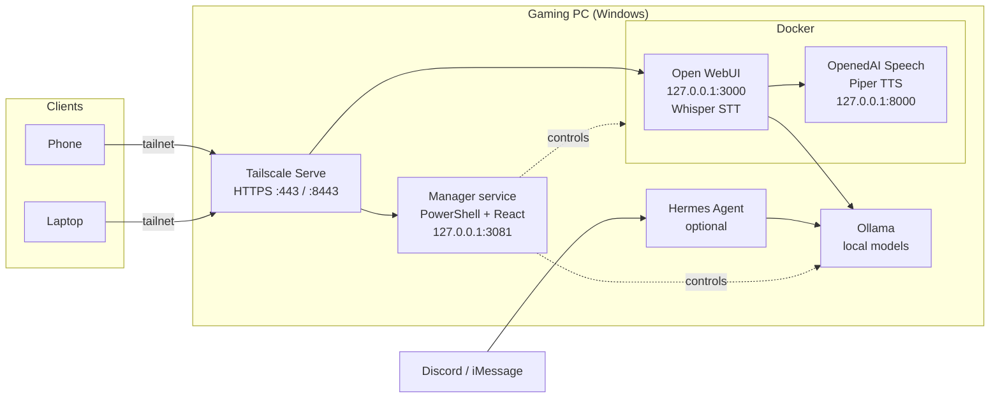

# Homelab AI

[](https://github.com/AzaWoodyy/homelab-ai/actions/workflows/ci.yml)
[](./LICENSE)

A private, self-hosted AI workspace that turns one Windows gaming PC into a personal AI server: local LLM chat, voice and camera mode, an optional messaging agent, and a secured remote dashboard, all reachable from a laptop or phone over Tailscale.

Inference and speech stay on the machine: models run in Ollama, speech-to-text and text-to-speech run locally, and every service listens on `127.0.0.1` only. Remote access goes through a Tailscale HTTPS tunnel. The only exception is the optional Hermes gateway, which exchanges messages with Discord or iMessage when you enable it.

<!-- Add a screenshot of the manager dashboard here, for example:

-->

## Highlights

- **One-command lifecycle.** PowerShell scripts install, start, stop, validate and refresh the whole stack (Docker, Ollama, Open WebUI, TTS, Tailscale Serve), with timestamped logs for every run.
- **Fully local voice and vision.** Whisper speech-to-text, Piper text-to-speech and a vision model (`llava:13b`) give Open WebUI a voice and camera mode that works offline once set up.
- **Remote management dashboard.** A host-native PowerShell HTTP service plus a React/TypeScript SPA to watch health, edit config and models, and run actions (restart, apply, sleep, shutdown) from a phone.
- **Security by default.** Loopback-only ports, HTTPS through Tailscale, hashed sessions, `HttpOnly`/`SameSite=Strict` cookies, CSRF tokens, constant-time secret comparison, sign-in throttling, and secrets kept out of git.
- **Optional agent gateway.** [Hermes Agent](./docs/hermes.md) can answer on Discord or iMessage using the same local models, with allowlists on every channel.
- **Pluggable runtime.** Docker and Ollama can run either natively on Windows or inside Ubuntu on WSL 2; the scripts route commands through `wsl.exe` when needed.

## Architecture



Main request paths:

- Chat: `client -> Tailscale -> Open WebUI -> Ollama -> local model`
- Voice: `microphone -> Whisper (in Open WebUI) -> Ollama -> Piper -> speaker`
- Messaging: `Discord or iMessage -> Hermes gateway -> Ollama`

## Tech stack

| Area | Tools |
| --- | --- |
| Inference | Ollama, Qwen 3, Llava, Hermes 3 |
| Chat UI | Open WebUI (pinned `v0.9.6`) |
| Speech | Whisper (STT), Piper via OpenedAI Speech (TTS) |
| Automation | PowerShell 7 / Windows PowerShell, Docker Compose, WSL 2, Windows Task Scheduler |
| Dashboard | React 19, TypeScript, TanStack Query, React Hook Form, Zod, Radix UI, Vite, Vitest |
| Networking | Tailscale (MagicDNS, Serve, HTTPS certificates) |
| CI | GitHub Actions: PowerShell parsing, PSScriptAnalyzer, config validation, UI typecheck, tests and build |

## Quick start

Prerequisites: Windows 11 (an NVIDIA GPU is strongly recommended), Docker Desktop (or WSL 2), [Ollama](https://ollama.com), [Tailscale](https://tailscale.com) with MagicDNS and HTTPS certificates enabled, and Node.js 22.12+ to build the dashboard. Run the scripts from an elevated PowerShell session.

```powershell
# 1. Local secrets (ignored by git)
Copy-Item config\homelab.local.example.json config\homelab.local.json
# then edit webui_secret_key and management_admin_secret

# 2. Optional: run Docker Engine and Ollama inside WSL instead of Windows.
#    First set runtime.container_backend / runtime.ollama_backend in config\homelab.json
#    (see docs/configuration.md), otherwise this script has nothing to do.
.\scripts\wsl-bootstrap.ps1

# 3. Pull models, warm up voices, validate prerequisites
.\scripts\setup.ps1

# 4. Start the stack and check it end to end
.\scripts\start.ps1
.\scripts\test.ps1

# 5. Build and start the remote dashboard
cd manager-ui; npm.cmd ci; npm.cmd run build; cd ..
.\scripts\manager-start.ps1
```

Open WebUI is then available at `https://<machine>.<tailnet>.ts.net` and the dashboard at `https://<machine>.<tailnet>.ts.net:8443`.

Stop the stack with `.\scripts\stop.ps1`, and the dashboard with `.\scripts\manager-stop.ps1`.

The Hermes messaging gateway is disabled by default. To use it, follow [docs/hermes.md](./docs/hermes.md) and set `hermes.enabled` to `true`.

## Documentation

| Topic | Doc |
| --- | --- |
| Every script and what it does | [docs/scripts.md](./docs/scripts.md) |
| Configuration, secrets and runtime backends | [docs/configuration.md](./docs/configuration.md) |
| Default models and the optional catalog | [docs/models.md](./docs/models.md) |
| Remote access, voice and camera mode | [docs/remote-access.md](./docs/remote-access.md) |
| Hermes Agent (Discord, iMessage) | [docs/hermes.md](./docs/hermes.md) |
| Wake-on-LAN companion setup | [docs/wake-on-lan.md](./docs/wake-on-lan.md) |
| File-by-file map of the repo | [docs/repository-map.md](./docs/repository-map.md) |
| Release notes | [CHANGELOG.md](./CHANGELOG.md) |

## Repository layout

```text
config/       runtime config, model list, local secret example
docker/       Docker Compose stack (Open WebUI, OpenedAI Speech)
docs/         operator and contributor documentation
manager-ui/   React + TypeScript dashboard served by the manager service
scripts/      PowerShell entry points (setup, start, stop, test, manager-*, hermes-*)
scripts/lib/  shared PowerShell modules loaded by scripts/common.ps1
```

## Development

```powershell
.\scripts\check.ps1          # parse all PowerShell, validate config JSON, typecheck + test the UI
cd manager-ui; npm.cmd run dev   # dashboard dev server on 127.0.0.1
```

The same checks run in GitHub Actions on every push and pull request.

## License

[MIT](./LICENSE)
